# Race Into Space

**A hobby remake of the 1993 space-race strategy game, rebuilt from scratch in Godot 4 with new art, a third superpower, and every screen redrawn for modern displays.**

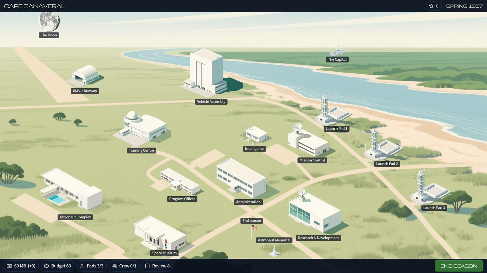

You run a national space programme from Spring 1957 to Fall 1977. Buy rockets and capsules, pour money into research until they are safe enough to fly, recruit and train astronauts, plan missions step by step, and race your rivals to be first to land a crew on the Moon and bring them home. Every launch plays out on the mission-control wall, and a bad season can cost you your director's job.

This is a fan reimplementation of *Race Into Space* (Strategic Visions / Interplay, 1993). The rules and data come from the open-source GPL port of that game; the engine, interface and art are all new. See [Licence and sources](#licence-and-sources) for exactly what is and is not borrowed.

> **Status: playable, pre-1.0.** The full 21-year campaign plays end to end against AI rivals that do reach the Moon. Art is complete; the music is still placeholder, and the 1.0 release work (packaging, a player manual) is in progress. See [Roadmap](#roadmap).

---

## Contents

- [Three space programmes](#three-space-programmes)
- [The spaceport](#the-spaceport)
- [Hardware](#hardware)
- [Planning and flying missions](#planning-and-flying-missions)
- [Astronauts](#astronauts)
- [Politics, news and history](#politics-news-and-history)
- [Accessibility and settings](#accessibility-and-settings)
- [Running the game](#running-the-game)
- [Building from source](#building-from-source)
- [How it's made](#how-its-made)
- [Project layout](#project-layout)
- [Roadmap](#roadmap)
- [Licence and sources](#licence-and-sources)

---

## Three space programmes

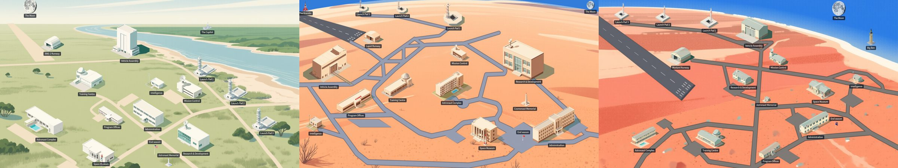

The original game was a two-way race. This one adds a third: **the Commonwealth**, a British-led programme flying from Woomera in the Australian outback with its own rockets, capsules, landers, newsreader, intelligence service (MI6) and prime minister to answer to.

| | United States | Soviet Union | Commonwealth |
|---|---|---|---|
| Spaceport | Cape Canaveral | Baikonur | Woomera |
| Rockets | Atlas, Titan, Saturn, Nova | R-7, Proton, N1, UR-700 | Monarch I and II, Super-Monarch, Magna-Imperial |
| Hardware | The original game's | The original game's | 7% cheaper, starting at 70% of the US safety |
| Intelligence | CIA | KGB | MI6 |
| Reports to | The President | The Politburo | The Prime Minister |

Play any side against one or two AI rivals, or share one computer **hot-seat** with up to two friends: each director takes their turn in order, with a handover screen between so nobody sees anyone else's plans, and the launches play out together. Difficulty and astronaut quality are set per side. The Commonwealth's costs and safety were tuned over hundreds of seeded AI-versus-AI games per match-up so that the three-way race is even (289, 275 and 302 wins for the Commonwealth, United States and Soviet Union over 600 games); head to head the Soviet Union keeps an edge. The balance runs also turned up and fixed a seat-order bias in the original rules ([tuning notes](docs/specs/tuning-notes.md)). Factions are pure data and art, so a fourth is a matter of filling in [the faction guide](docs/adding-a-faction.md).

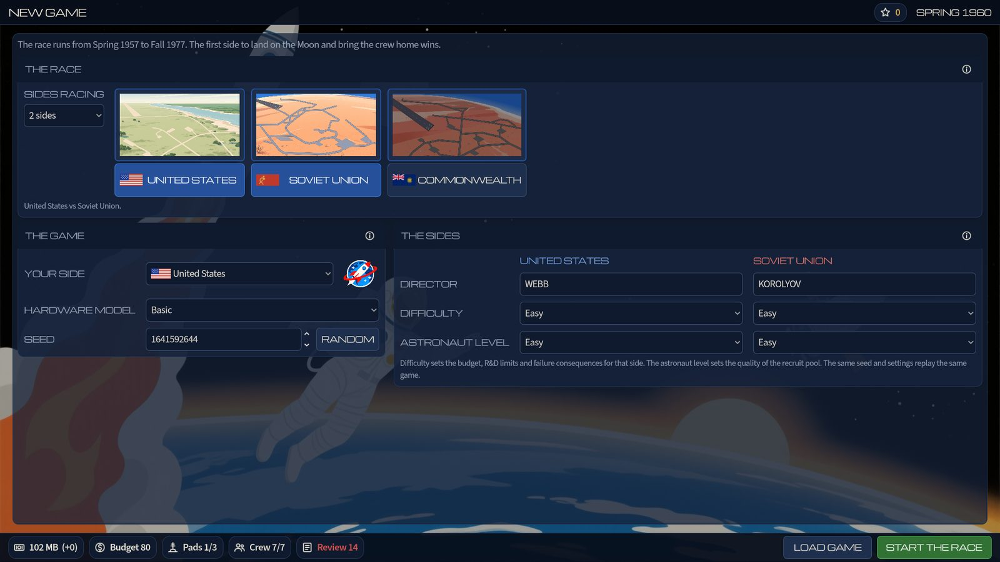

## The spaceport

Each side's spaceport is a single hand-composed scene, laid out on the roads, runway and launch complexes of its real site. Buildings appear as you buy into them: launch pads go up (and come down again after an explosion), a spaceplane runway and hangar arrive with the spaceplane programme, and the Moon and your capital sit on the horizon. Click any building to go inside.

- **Administration**: budget office, hardware purchase, future missions, recruiting and preferences
- **Research & Development** and **Program Offices**: improve safety, run the hardware programmes
- **Vehicle Assembly**, **Launch Pads** and **Mission Control**: put vehicles together and fly them
- **Astronaut Complex** and **Training Centre**: crews, morale and advanced training
- **Intelligence**: what the CIA, KGB or MI6 think the rivals are building
- **Space Museum**, **Memorial** and **the Moon**: firsts, the fallen, and photo-reconnaissance of landing sites

## Hardware

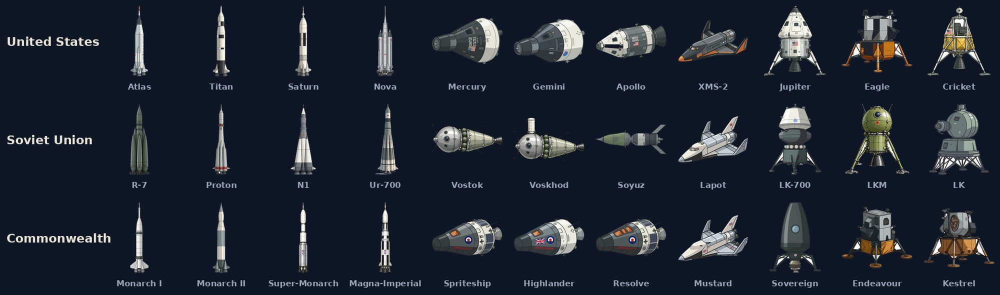

Each side has 21 hardware programmes: probes and satellites, four rocket families plus strap-on boosters, seven crewed craft from one-man capsules to direct-ascent lunar landers and spaceplanes, upper-stage kickers, EVA suits, docking modules and photo-reconnaissance. Every illustration is drawn to its real counterpart, down to Mercury's shingles, the R-7's strap-ons and Vostok's ring of gas bottles.

Buying a programme is only the start. A new rocket arrives at a few percent safety; research drives it up toward its ceiling, flights add experience, and failures, events and sabotage knock it back down.

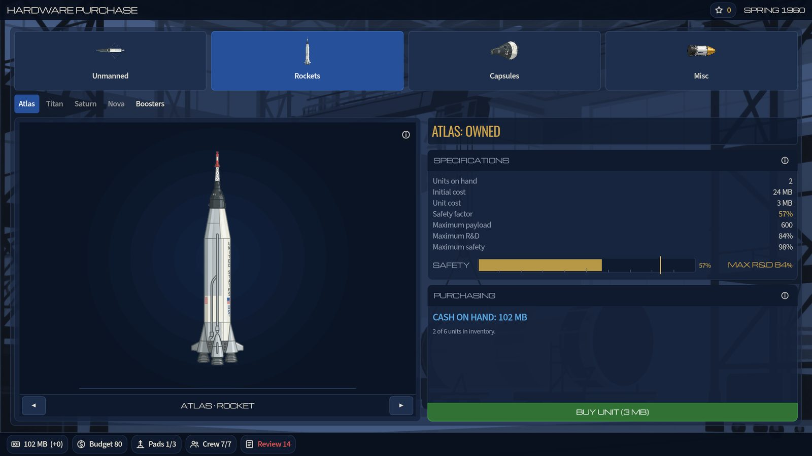

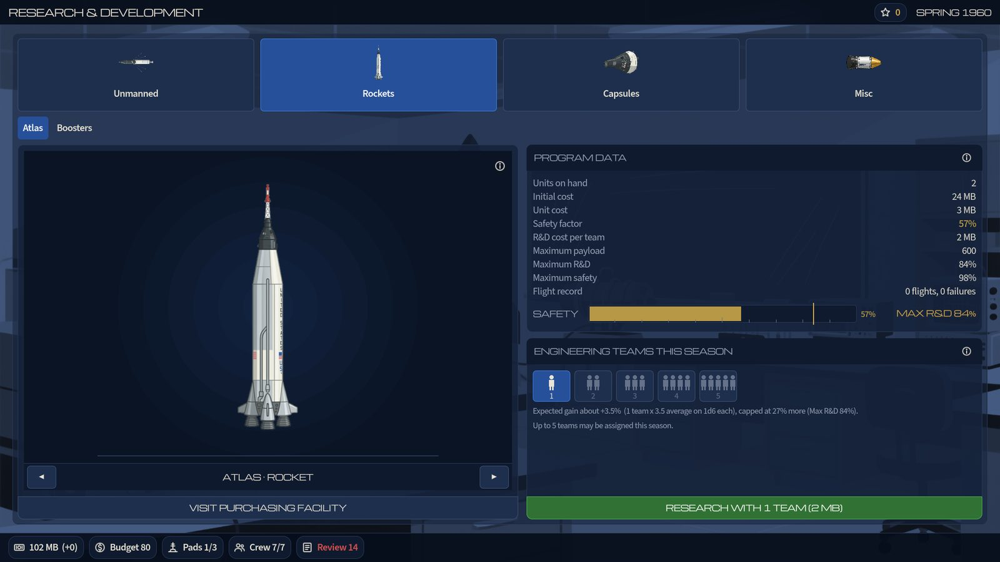

## Planning and flying missions

62 mission types, from a first orbital satellite through crewed orbital, rendezvous, docking and EVA flights, lunar flybys and orbits, to the landing itself, plus planetary probes. Each mission is a chain of steps (launch, engine burns, re-entry, docking, lunar descent…), and each step rolls against the safety of the hardware flying it.

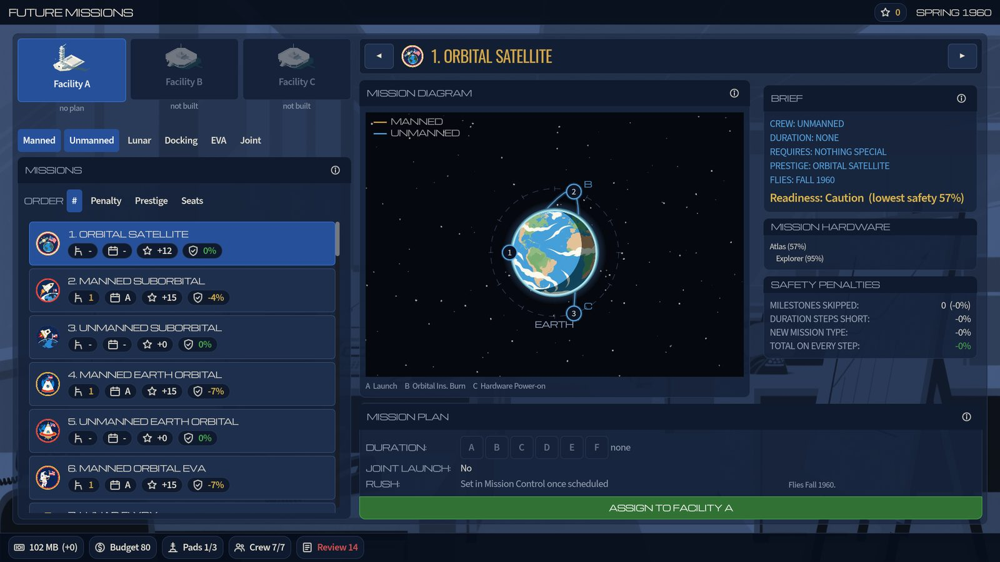

Plan missions a season ahead, assign them to launch facilities, assemble the vehicle and crew, and decide whether to rush. Then lower the flag and watch.

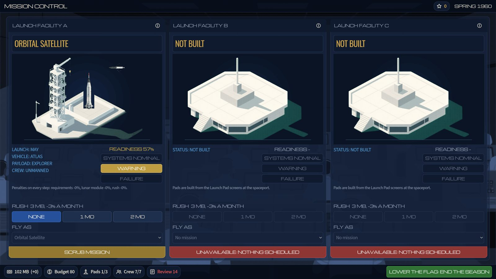

### Every launch is animated

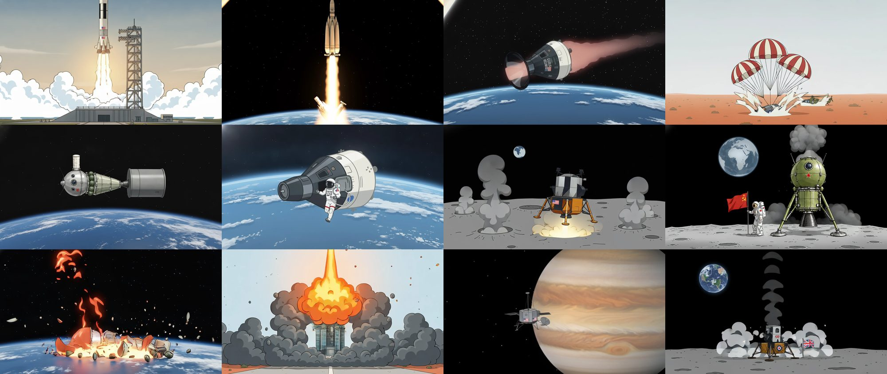

Each step of a flight plays as a short animated vignette on the mission-control wall, showing **the vehicle you are actually flying**, in your side's markings, for success or failure: 246 clips across 18 kinds of step and all three programmes. A Vostok re-entry is a Vostok, a Commonwealth recovery comes down in the red desert, and a pad failure is a fireball on your own launch complex.

## Astronauts

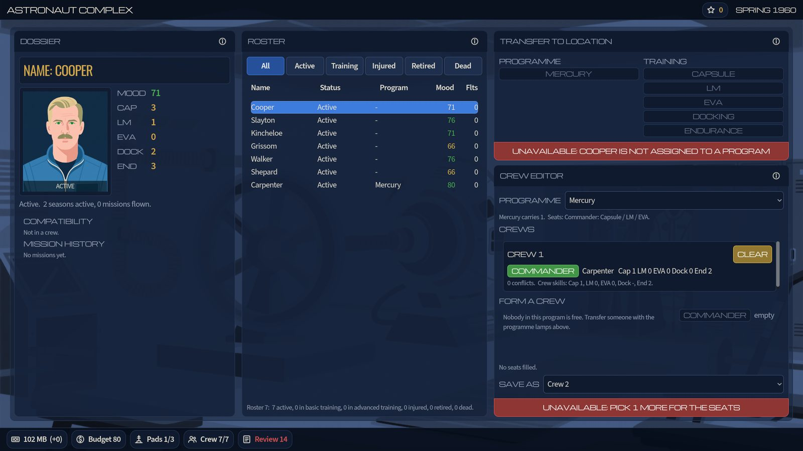

Recruit groups of astronauts, cosmonauts and Commonwealth crews (112 named candidates per side, each with a portrait), put them through basic and advanced training in capsule, lunar module, EVA, docking and endurance work, and build crews that get on. Mood, injuries, retirements and losses all matter, and the dead are remembered on each side's memorial wall.

## Politics, news and history

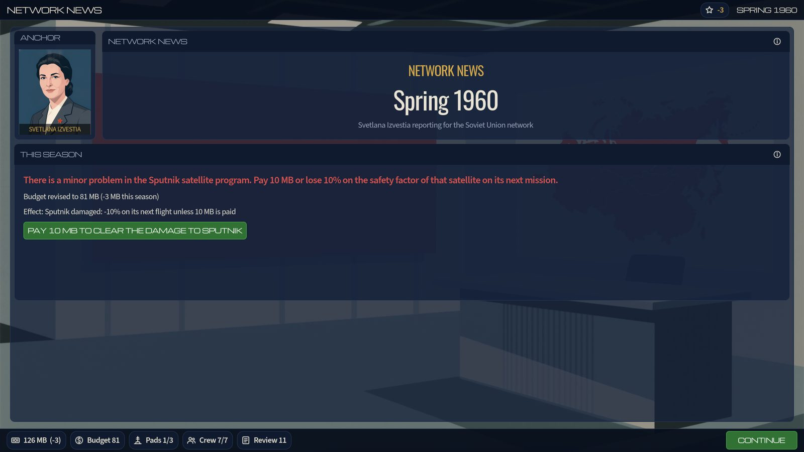

Each season opens with the network news (Carter Walcrite in the United States, Svetlana Izvestia in the Soviet Union, Roland Ashcombe for the Commonwealth), bringing budget changes, windfalls, strikes, sabotage and the wider events of the 1960s and 70s. Once a year your programme is reviewed by the President, the Politburo or the Cabinet, and too many poor years end your director's career.

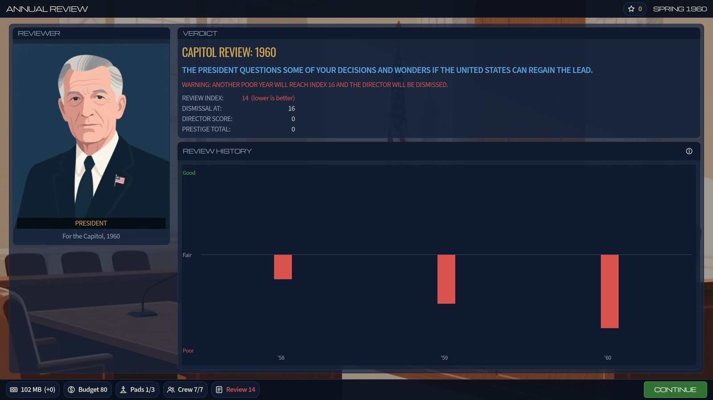

The Space Museum keeps the hall of firsts, records and each side's achievements.

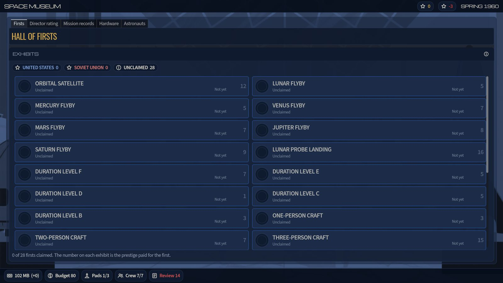

## Accessibility and settings

- **UI scale** from 0.75× to 2×, with a resolution-independent interface that stays sharp from 1080p to 4K
- **Colour-blind friendly status colours**: the green, amber and red used for go, caution and failure can be switched to blue, yellow and orange, which stay distinct under red-green and blue-yellow colour blindness
- **Keyboard play**: Tab and arrow keys move between controls, Enter presses, Esc goes back
- Windowed or fullscreen, an integer-scaling pixel mode, separate music and effects volumes, and adjustable or skippable launch playback
- **Original soundtrack support**: if you own the original game, point the settings at its music folder and the game plays those tracks in the right places, falling back to its own music for anything missing

## Running the game

There are no release builds yet. To play now, [build from source](#building-from-source) or open the project in Godot and press Play.

Saved games live in Godot's user data folder (`~/.local/share/godot/app_userdata/Race Into Space/` on Linux). Saves are versioned: older saves are upgraded when loaded, and a save from a newer version is refused with an explanation rather than half-loaded.

## Building from source

You need **[Godot 4.7.2](https://godotengine.org/download)** (standard build, not .NET).

```sh
git clone https://github.com/windin101/race-into-space.git
cd race-into-space
godot --path game            # opens and runs the game
```

**Tests.** The project has a gdUnit4 suite (over 200 tests, bundled under `game/addons/`) and a simulation regression gate that replays twenty seeded AI-versus-AI games and checks every season's numbers are unchanged. Both run headless and on every push through GitHub Actions.

```sh
tools/run_tests.sh           # unit and scene tests
tools/check_fingerprint.sh   # rules regression gate (--record to re-baseline after a deliberate rules change)
```

Both use `$GODOT_BIN` if set, otherwise `~/.local/bin/godot`.

**Exports.** Install the Godot 4.7.2 export templates, then:

```sh
cd game
godot --headless --export-release "Linux" ../build/linux/race-into-space.x86_64
../build/linux/race-into-space.x86_64 --headless -- --self-check   # smoke-tests the packed build
```

Presets exist for Linux and Windows. The packed game is currently about 670 MB, almost all of it mission vignettes.

**Screenshots** of every screen, for every side, at several window sizes:

```sh
godot --path game res://tools/ui_screenshots.tscn -- --out ../docs/screens/latest [--side ussr] [--only spaceport,newscast]
```

## How it's made

- **Engine:** Godot 4.7, GDScript throughout. The simulation never touches the scene tree; screens read the game state and send commands, which keeps the rules testable headless.
- **Rules and data:** every number lives in `game/data/` as JSON with a note on where it came from: the GPL port's data files, the 1993 *Rules of Play* manual and reference card, or the port's C++ where neither documents the behaviour. [`docs/upstream-reference-map.md`](docs/upstream-reference-map.md) traces each table; [`docs/specs/code-derived-rules.md`](docs/specs/code-derived-rules.md) records rules recovered from code.
- **Art:** made for this project with locally run open models (Qwen-Image for illustrations, Wan 2.2 for animation) plus Gemini image generation for the vignette keyframes and 25 of the hardware illustrations, composed and corrected by hand: a locked camera angle and sun for every building so each spaceport reads as one scene, roads drawn as geometry from the player's own layouts, hardware drawn to the real vehicles. Tools and seeds are under `tools/`, and [`game/assets/MANIFEST.md`](game/assets/MANIFEST.md) lists every asset with its source and licence.
- **Text:** the original game's news, reviews and endings are ALL CAPS; the game shows them in proper sentence case using a casing dictionary built from that text, so names and acronyms survive (the KGB stays the KGB).

## Project layout

```
game/        The Godot project: open this folder in the editor
  data/      Rules and tables as JSON (missions, hardware, sides, events, text)
  scenes/    One scene per screen
  scripts/   sim/ (rules, headless), ui/, art/, playback/
  assets/    Art and audio, every file listed in assets/MANIFEST.md
  test/      gdUnit4 suites
tools/       Art pipelines, data import, tests, regression gate, screenshots
docs/        Plans, specs, style guides, tuning notes, this README's images
original/    (gitignored) the 1993 manuals, for reference
reference/   (gitignored) the GPL port, and art working files
```

## Roadmap

The plan is in [`docs/plan.md`](docs/plan.md). Phases 0 to 7 (foundations, data, simulation, interface, every screen, mission playback, AI, art) are done. Phase 8, polish and release, is under way:

- [x] Continuous integration (tests and regression gate on every push)
- [x] Save-game versioning and migration
- [x] Linux and Windows exports, with a packaged-build self-check
- [x] Colour-blind palette and keyboard navigation
- [ ] Full play-test pass
- [x] Hot-seat play for two or three people
- [ ] Original music to replace the placeholder loops
- [ ] Flatpak package and a tested Windows build
- [ ] A player manual
- [ ] 1.0 release

## Licence and sources

The code is licensed under the **GNU GPL, version 2 or later** ([LICENSE](LICENSE)), the same licence as the open-source port it builds on.

- **Rules and data** come from [raceintospace/raceintospace](https://github.com/raceintospace/raceintospace), the GPL port of the original game, and from the original 1993 manuals. That port is used as a reference; the engine here is written fresh rather than translated.
- **No original Interplay art, audio, video or fonts are included.** Every picture, animation and sound in this repository was made for this project and is listed with its source and licence in [`game/assets/MANIFEST.md`](game/assets/MANIFEST.md). AI-generated art is released as CC0.
- **Not affiliated** with the original publishers or with the open-source port, and not endorsed by anyone named in the original title. This project is called *Race Into Space* only.
- If you own the original game, you can play its soundtrack from your own copy (see [Accessibility and settings](#accessibility-and-settings)); none of it is distributed here.

This is a non-commercial hobby project.
